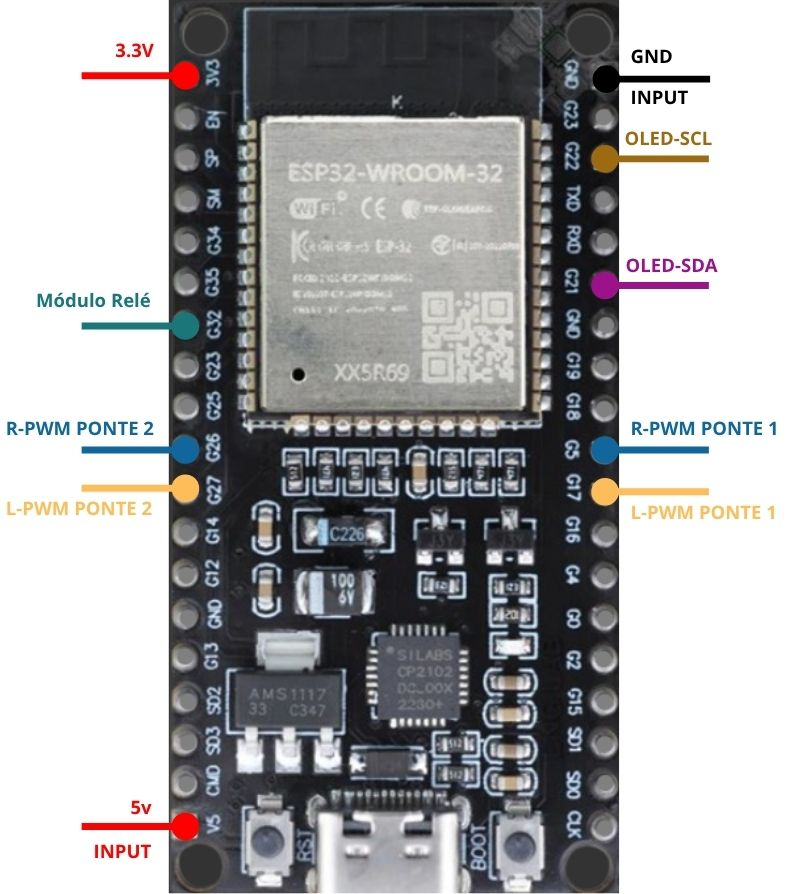
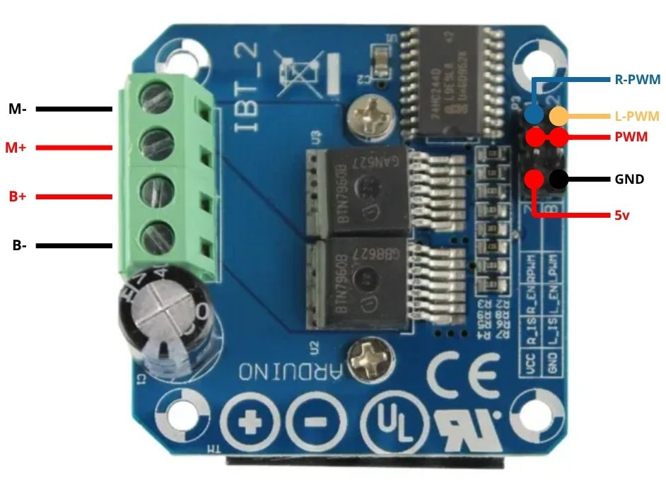
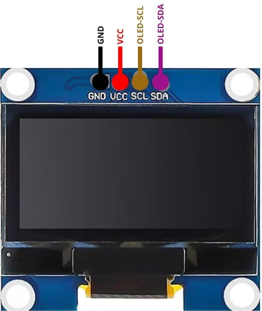
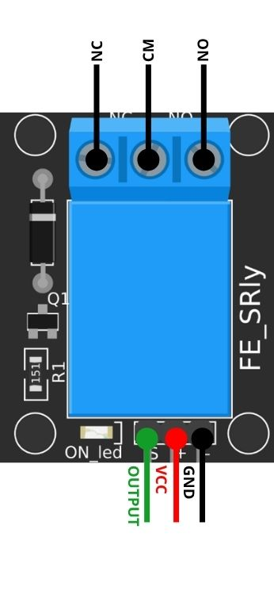
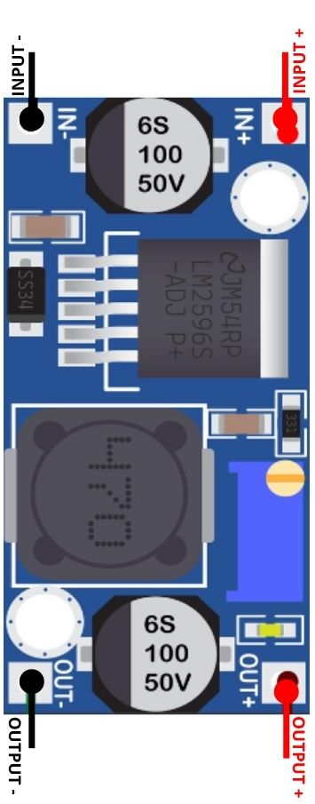
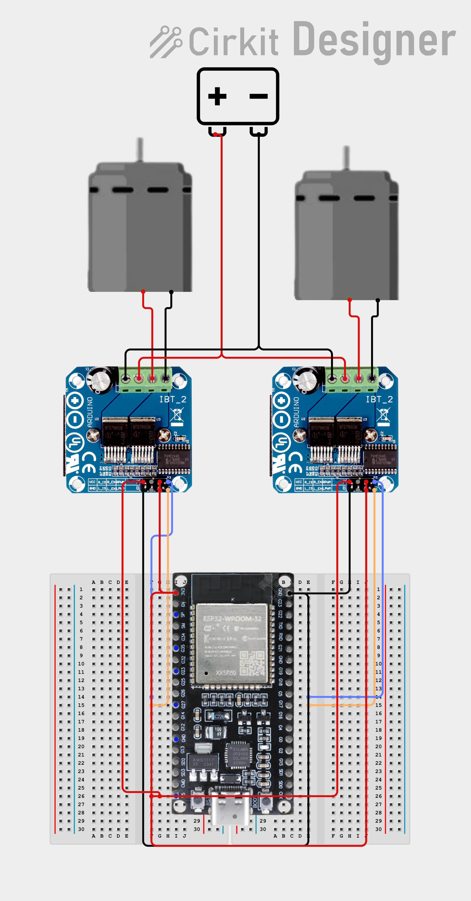

# 🤖 RoboLight — Robô Móvel Autônomo de Desinfecção UV-C

O **RoboLight** é um protótipo de robô móvel de duas rodas para desinfecção de ambientes clínicos e hospitalares por radiação ultravioleta germicida (UV-C). O sistema é controlado por um **ESP32** que atua como ponto de acesso Wi-Fi e serve uma interface web (dashboard) com WebSocket, aceitando controle por teclado, botões na tela e gamepads (PlayStation, Xbox e controles USB/Bluetooth).

---

## 📌 Índice
- [Visão Geral](#-visão-geral)
- [Tecnologia de Desinfecção UV-C](#-tecnologia-de-desinfecção-uv-c)
- [Componentes e Materiais](#-componentes-e-materiais)
- [Mapeamento de Pinos e Ligações](#-mapeamento-de-pinos-e-ligações)
- [Estrutura do Repositório](#️-estrutura-do-repositório)
- [Estrutura do Código (Firmware)](#-estrutura-do-código-firmware)
- [Configuração do Ambiente e Requisitos](#-configuração-do-ambiente-e-requisitos)
- [Protocolo de Comunicação](#-protocolo-de-comunicação)
- [Procedimento de Testes e Validação](#-procedimento-de-testes-e-validação)
- [Protocolo e Matriz de Segurança](#-protocolo-e-matriz-de-segurança)
- [Diagnóstico de Falhas (Troubleshooting)](#-diagnóstico-de-falhas-troubleshooting)

---

## 🔍 Visão Geral

O ESP32 executa um servidor web (porta 80) e um servidor WebSocket (porta 81). Ao conectar qualquer dispositivo (computador, smartphone ou tablet) à rede Wi-Fi gerada pelo robô e acessar `192.168.4.1`, o operador pode:

- **Movimentar o robô em 8 direções:** controle proporcional de velocidade e direção (frente, trás, esquerda, direita e diagonais).
- **Acionar a desinfecção com segurança:** liga e desliga remotamente o circuito de potência das lâmpadas UV-C por meio de um módulo relé.
- **Monitorar em tempo real:** estado do sistema no display OLED SSD1306 e vídeo ao vivo de uma câmera IP integrada à página via `iframe`.

---

## 💡 Tecnologia de Desinfecção UV-C

A radiação germicida na faixa UV-C (200 nm a 280 nm) provoca a formação de dímeros no DNA/RNA de microrganismos patogênicos (como *Clostridioides difficile* e MRSA), impedindo sua replicação e permitindo taxas de inativação biológica de Log-4 (99,99%).

### Dimensionamento dos emissores

- **Lâmpadas germicidas:** 5x **OSRAM PURITEC HNS 30W G13** (T8, 90 cm, 254 nm monocromática, *ozone-free*).
- **Reatores eletrônicos:** 3x **Philips Basic EB240A16/26 P Bivolt (110/220V)**.
  - Distribuição: Reator 1 (2x 30W), Reator 2 (2x 30W) e Reator 3 (1x 30W). Potência total de emissão: **150W**.
- **Alimentação AC de potência:** inversor DC/AC de 12V para 220V (1000W), exigindo corrente média de 15A do banco de baterias de 12V.

---

## 🛠️ Componentes e Materiais

| Componente | Qtd. | Especificação / Observação |
| :--- | :---: | :--- |
| **ESP32** | 1 | Placa de desenvolvimento (NodeMCU / Dev Module de 30 ou 38 pinos) |
| **Ponte H BTS7960 (IBT-2)** | 2 | Driver de alta corrente para motores CC (1 por motor) |
| **Motores CC com rodas** | 2 | Compatíveis com o chassi do robô |
| **Display OLED SSD1306** | 1 | 128x64 pixels, comunicação I²C (endereço `0x3C`) |
| **Lâmpadas UV-C** | 5 | OSRAM PURITEC HNS 30W G13 (*ozone-free*, 254 nm) |
| **Reatores eletrônicos** | 3 | Philips Basic EB240A16/26 P Bivolt |
| **Módulo relé (5V)** | 1 | Acionamento de potência do circuito UV-C |
| **Inversor de tensão** | 1 | 12V DC para 220V AC (1000W contínuos) |
| **Regulador Step-Down** | 1 | LM2596 (12V DC para 5V DC lógico) |
| **Bateria principal** | 1 | Bateria 12V (alimenta motores e inversor) |
| **Fonte / bateria do ESP32** | 1 | Alimentação separada e regulada para o microcontrolador |

---

## 📐 Mapeamento de Pinos e Ligações

### 1. Ligações no ESP32

| Função | Pino GPIO | Conexão de destino |
| :--- | :---: | :--- |
| **Módulo relé (UV-C)** | **GPIO 32** | Pino de sinal (`S` / `IN`) do módulo relé |
| **LED onboard / status** | **GPIO 2** | Indicador visual integrado à placa |
| **Luz auxiliar / status** | **GPIO 32** | Sinalizador secundário de acionamento |
| **Ponte H 1 (motor esquerdo) — sentido 1** | **GPIO 26** | `RPWM` da Ponte H 1 |
| **Ponte H 1 (motor esquerdo) — sentido 2** | **GPIO 27** | `LPWM` da Ponte H 1 |
| **Ponte H 2 (motor direito) — sentido 1** | **GPIO 5** | `RPWM` da Ponte H 2 |
| **Ponte H 2 (motor direito) — sentido 2** | **GPIO 17** | `LPWM` da Ponte H 2 |
| **Display OLED — SDA** | **GPIO 21** | Terminal SDA do display |
| **Display OLED — SCL** | **GPIO 22** | Terminal SCL do display |
| **Alimentação lógica (5V)** | **VIN / 5V** | Saída `OUT+` (5V) do regulador LM2596 |
| **GND comum** | **GND** | Referência comum |

<p align="center">
  
</p>

### 2. Detalhes de conexão dos módulos

- **Pontes H BTS7960 (IBT-2):**
  - `B+` e `B-`: bateria dos motores (12V) e GND comum.
  - `M+` e `M-`: terminais dos respectivos motores CC.
  - `VCC` e `GND`: 5V e GND da lógica.
  - `R_EN` e `L_EN`: em **nível alto (5V)** permanente.

  <p align="center">
    
  </p>
- **Módulo relé (FE_SRly):**
  - `VCC` (`+`): 5V.
  - `GND` (`-`): GND comum.
  - `OUTPUT` (`S`): **GPIO 32** do ESP32.
  - `COM` e `NO` (normalmente aberto): interrompem a fase (L) de 220V AC entre o inversor e os reatores.
- **Regulador Step-Down LM2596:**
  - `IN+` / `IN-`: bateria de 12V.
  - `OUT+` / `OUT-`: regulados em **5,0V** para alimentar o ESP32, o relé e a lógica das pontes H.

- **Display OLED SSD1306:**
  - `GND` e `VCC`: GND comum e alimentação.
  - `SCL`: **GPIO 22** do ESP32.
  - `SDA`: **GPIO 21** do ESP32.

  <p align="center">
    
  </p>

### 3. Pinagem do módulo relé (FE_SRly)

<p align="center">
  
</p>

| Pino do módulo | Conexão |
| :--- | :--- |
| **S / OUTPUT** (sinal) | **GPIO 32** do ESP32 |
| **VCC** (`+`) | 5V |
| **GND** (`-`) | GND comum |
| **COM** (`CM`) | Fase (L) de 220V AC vinda do inversor |
| **NO** (normalmente aberto) | Fase (L) de 220V AC em direção aos reatores |
| **NC** (normalmente fechado) | Não utilizado |

O relé interrompe a fase entre o inversor e os reatores: com o GPIO 32 em nível alto, o circuito fecha e as lâmpadas UV-C acendem.

### 4. Pinagem do regulador Step-Down (LM2596)

<p align="center">
  
</p>

| Pino do módulo | Conexão |
| :--- | :--- |
| **INPUT +** (`IN+`) | Positivo da bateria de 12V |
| **INPUT -** (`IN-`) | Negativo da bateria de 12V |
| **OUTPUT +** (`OUT+`) | 5V para o pino VIN/5V do ESP32, o relé e a lógica das pontes H |
| **OUTPUT -** (`OUT-`) | GND comum |

Ajuste o trimpot (parafuso azul da placa) para **5,0V** medindo a saída com um multímetro, antes de ligar o ESP32.

---

## 🗂️ Estrutura do Repositório

```
RoboLight/
├── README.md
├── firmware/
│   └── RoboLight/                 # firmware principal (v3.0)
│       ├── RoboLight.ino
│       ├── html_page.h
│       ├── PonteH.h
│       ├── LCD.h
│       ├── WiFiAP.h
│       └── functions.h
├── testes/
│   ├── controle_wifi_2pontes/     # teste das duas pontes H e gamepad
│   └── teste_rele_uvc/            # teste do módulo relé / UV-C
├── doc/                           # dossiê técnico e guia do IP Webcam (PDF)
├── images/                        # esquemáticos, fotos de placas e testes
└── videos/                        # vídeos dos testes
```

> Cada sketch fica em uma pasta com o mesmo nome do `.ino`, como exige a Arduino IDE.

---

## 📁 Estrutura do Código (Firmware)

> ⚠️ **Aviso crítico de compilação:**
> em `RoboLight.ino`, a ordem dos `#include` **não pode ser alterada**, sob risco de erros de compilação ou falhas de execução:
> ```cpp
> #include "html_page.h"
> #include "PonteH.h"
> #include "LCD.h"
> #include "WiFiAP.h"
> #include "functions.h"
> ```

Todos esses arquivos devem ficar na mesma pasta do `RoboLight.ino`.

O firmware completo está em [`firmware/RoboLight/`](firmware/RoboLight/) (`RoboLight.ino`, `html_page.h`, `PonteH.h`, `LCD.h`, `WiFiAP.h` e `functions.h`).

---

## ⚙️ Configuração do Ambiente e Requisitos

- **IDE:** Arduino IDE, com o pacote de placas ESP32 na série **2.x** (ex.: v2.0.17).
- **Atenção:** a série 3.x do pacote ESP32 altera as funções de PWM (`ledcSetup` e `ledcAttachPin`), sendo incompatível sem adaptações.
- **Driver:** Silicon Labs CP210x USB to UART Bridge.
- **Bibliotecas necessárias:**
  - ESP32 (Espressif Systems)
  - WebServer (Espressif Systems)
  - WebSockets, de Markus Sattler (Links2004)
  - Adafruit GFX Library
  - Adafruit SSD1306
  - Adafruit BusIO

---

## 📡 Protocolo de Comunicação

Mensagens enviadas da interface web ➔ ESP32:

| Comando | Ação executada |
| :--- | :--- |
| `ComandoDirecao=F` | Movimento para frente |
| `ComandoDirecao=T` | Movimento para trás |
| `ComandoDirecao=E` | Rotação para a esquerda |
| `ComandoDirecao=D` | Rotação para a direita |
| `ComandoDirecao=G` / `I` | Diagonais para frente (esquerda / direita) |
| `ComandoDirecao=H` / `J` | Diagonais para trás (esquerda / direita) |
| `ComandoDirecao=P` | Para os motores imediatamente |
| `LEDonoff=ON` / `OFF` | Liga ou desliga o módulo relé (lâmpadas UV-C) e os LEDs |
| `Velocidade=<0-255>` | Define a velocidade dos motores (valor PWM de 0 a 255) |

---

## 🧪 Procedimento de Testes e Validação

### Etapas 1 a 9 — Guia integrado

1. **Verificação elétrica:** confirmar o GND comum e os pinos `R_EN`/`L_EN` em nível alto antes de ligar a bateria dos motores.
2. **Upload e Monitor Serial:** gravar o código e abrir o monitor a 115200 baud. Confirmar a mensagem `Rede criada. IP: 192.168.4.1`.
3. **Conexão e teste de rotação:** acessar `http://192.168.4.1` com as rodas do robô suspensas, para validar a polaridade e o sentido de rotação dos motores.

### Etapa 10 — Teste individual do módulo relé / UV-C via Wi-Fi

Sketch em arquivo único que cria uma rede dedicada (`RoboLight-UVC-Test`) para testar o acionamento remoto do módulo relé (GPIO 32) em bancada.

Código: [`testes/teste_rele_uvc/teste_rele_uvc.ino`](testes/teste_rele_uvc/teste_rele_uvc.ino)

### Etapa 11 — Teste de validação dos motores e gamepad

Sketch para testar individualmente a tração das duas pontes H, com suporte nativo a gamepads USB/Bluetooth via Gamepad API. O arquivo `new_html_pages_gamepad.h` precisa ficar na mesma pasta do sketch.

**Esquemático da versão de teste das duas pontes H** (Cirkit Designer):



Código: [`testes/controle_wifi_2pontes/`](testes/controle_wifi_2pontes/) (`controle_wifi_2pontes.ino` e `new_html_pages_gamepad.h`).

---

## 🚨 Protocolo e Matriz de Segurança

O projeto adota proteção em três níveis para garantir operação clínica sem riscos:

- **Nível 1 (software):** parada automática e imediata dos motores ao detectar desconexão do WebSocket (`WStype_DISCONNECTED`).
- **Nível 2 (firmware):** resistor pull-down e estado `LOW` garantido no `setup()` para impedir o disparo involuntário das lâmpadas UV-C durante o boot do ESP32.
- **Nível 3 (hardware / físico):** botoeira de emergência física e corte manual da alta potência.

**Equipamentos de Proteção Individual (EPIs):** uso obrigatório de óculos com proteção UV400, protetor facial integral (*face shield*) e luvas de nitrila em qualquer teste de bancada com lâmpadas expostas.

---

## 🔍 Diagnóstico de Falhas (Troubleshooting)

| Sintoma | Causa provável | Ação recomendada |
| :--- | :--- | :--- |
| `Brownout detector was triggered` | Queda de tensão por pico de corrente dos motores | Alimentar o ESP32 por fonte separada; adicionar capacitor de 470µF a 1000µF na linha de 5V |
| Display OLED não encontrado (`0x3C`) | Falha de comunicação no barramento I²C | Verificar os pinos SDA (GPIO 21), SCL (GPIO 22) e a alimentação de 5V |
| Relé UV-C não aciona | Fiação do pino de sinal ou GND incompleto | Inspecionar a conexão do GPIO 32 no pino S/IN do relé e o GND comum |
| Erro de compilação em `ledcSetup` | Pacote de placas ESP32 na série 3.x | Usar o pacote ESP32 série 2.x (ex.: 2.0.17) no Gerenciador de Placas |
