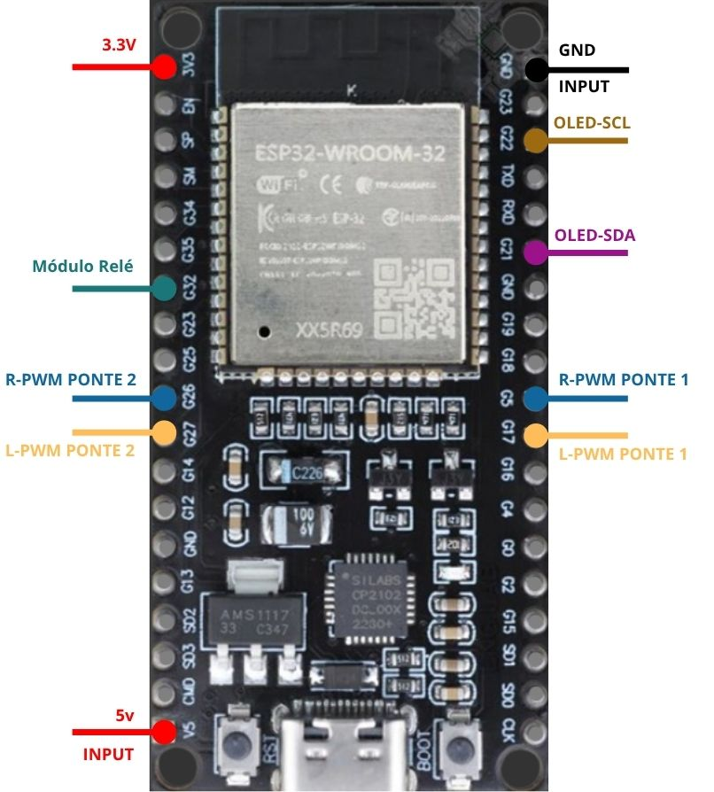
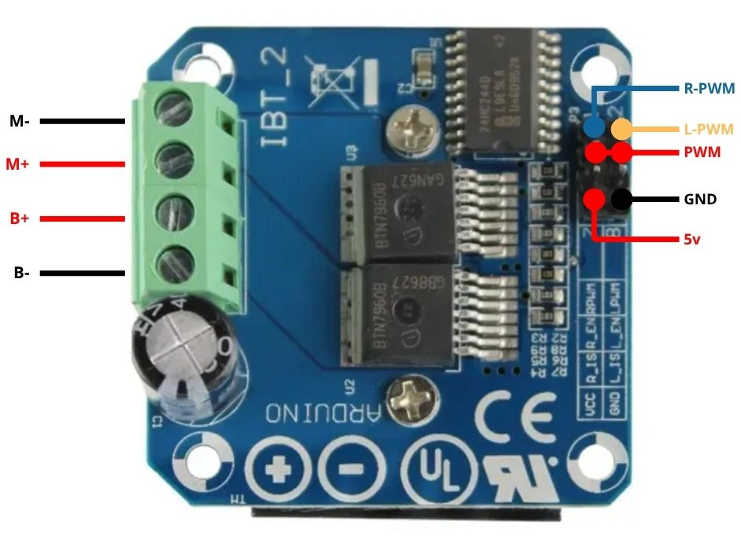
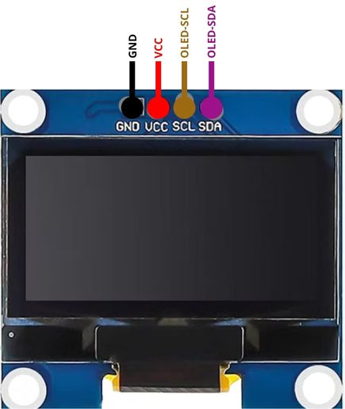
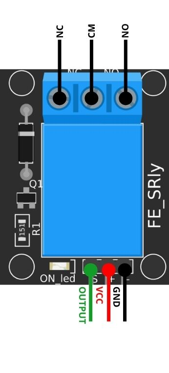
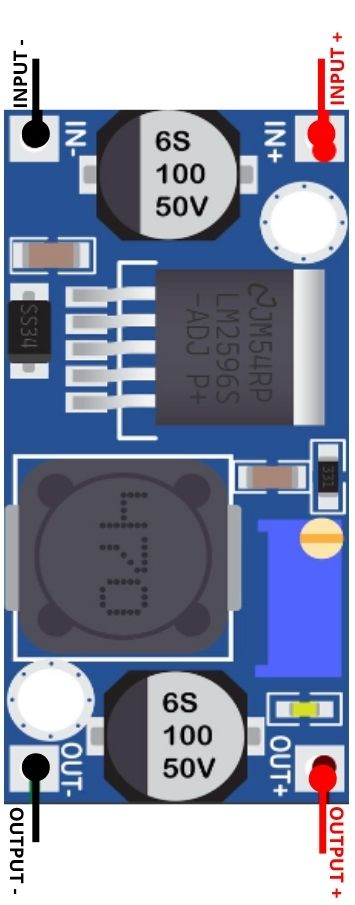
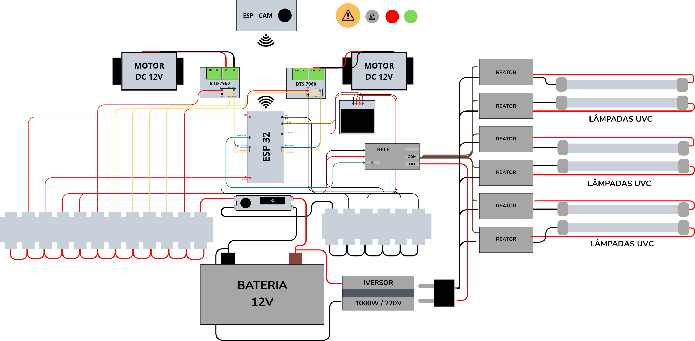
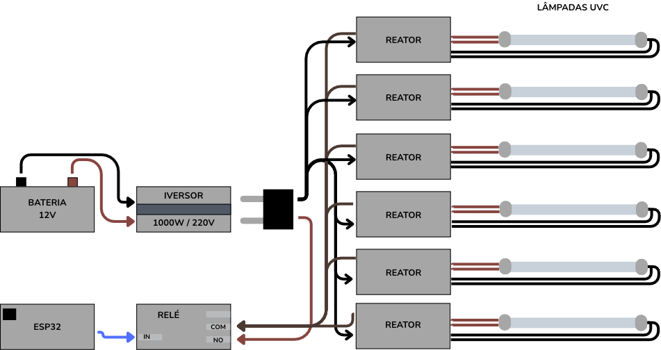
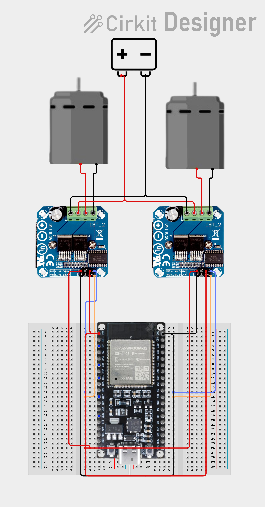

# 🤖 RoboLight — Robô Móvel Autônomo de Desinfecção UV-C

O **RoboLight** é um protótipo de robô móvel de duas rodas para desinfecção de ambientes clínicos e hospitalares por radiação ultravioleta germicida (UV-C). O sistema é controlado por um **ESP32** que atua como ponto de acesso Wi-Fi e serve uma interface web (dashboard) com WebSocket, aceitando controle por teclado, botões na tela e gamepads (PlayStation, Xbox e controles USB/Bluetooth).

---

## 📌 Índice
- [Visão Geral](#-visão-geral)
- [Tecnologia de Desinfecção UV-C](#-tecnologia-de-desinfecção-uv-c)
- [Componentes e Materiais](#-componentes-e-materiais)
- [Mapeamento de Pinos e Ligações](#-mapeamento-de-pinos-e-ligações)
- [Estrutura do Repositório](#️-estrutura-do-repositório)
- [Estrutura do Código (Firmware)](#-estrutura-do-código-firmware)
- [Configuração do Ambiente e Requisitos](#-configuração-do-ambiente-e-requisitos)
- [Configuração da ESP32-CAM](#configuração-da-esp32-cam)
- [Protocolo de Comunicação](#-protocolo-de-comunicação)
- [Controle de Aceleração Suave](#-controle-de-aceleração-suave-soft-start)
- [Sistema de Ligação das Lâmpadas UVC](#sistema-de-ligação-das-lâmpadas-uvc)
- [Procedimento de Testes e Validação](#-procedimento-de-testes-e-validação)
- [Protocolo e Matriz de Segurança](#-protocolo-e-matriz-de-segurança)
- [Diagnóstico de Falhas (Troubleshooting)](#-diagnóstico-de-falhas-troubleshooting)

---

## 🔍 Visão Geral

O ESP32 executa um servidor web (porta 80) e um servidor WebSocket (porta 81). Ao conectar qualquer dispositivo (computador, smartphone ou tablet) à rede Wi-Fi gerada pelo robô e acessar `192.168.4.1`, o operador pode:

- **Movimentar o robô em 8 direções:** controle proporcional de velocidade e direção (frente, trás, esquerda, direita e diagonais).
- **Controlar as lâmpadas UV-C:** liga e desliga remotamente o circuito de potência por meio de um módulo relé.
- **Monitorar em tempo real:** o OLED SSD1306 exibe os dados da rede, e o painel web mostra o vídeo MJPEG da ESP32-CAM e oferece ajustes da câmera.

---

## 💡 Tecnologia de Desinfecção UV-C

A radiação germicida na faixa UV-C (200 nm a 280 nm) provoca a formação de dímeros no DNA/RNA de microrganismos patogênicos (como *Clostridioides difficile* e MRSA), impedindo sua replicação e permitindo taxas de inativação biológica de Log-4 (99,99%).

### Dimensionamento dos emissores

- **Lâmpadas germicidas:** 6x **OSRAM PURITEC HNS 30W G13** (T8, 90 cm, 254 nm monocromática, *ozone-free*), com potência nominal total de **180 W**.
- **Reatores eletrônicos:** 6x **Philips Basic EB240A16/26 P Bivolt (110/220V)**.
- **Alimentação AC de potência:** inversor DC/AC de 12V para 220V (1000W).

---

## 🛠️ Componentes e Materiais

| Componente | Qtd. | Especificação / Observação |
| :--- | :---: | :--- |
| **ESP32** | 1 | Placa de desenvolvimento (NodeMCU / Dev Module de 30 ou 38 pinos) |
| **ESP32-CAM (OV2640)** | 1 | Módulo AI Thinker com câmera OV2640 e firmware próprio |
| **Ponte H BTS7960 (IBT-2)** | 2 | Driver de alta corrente para motores CC (1 por motor) |
| **Motores CC com rodas** | 2 | Compatíveis com o chassi do robô |
| **Display OLED SSD1306** | 1 | 128x64 pixels, comunicação I²C (endereço `0x3C`) |
| **Lâmpadas UV-C** | 6 | OSRAM PURITEC HNS 30W G13 (*ozone-free*, 254 nm) |
| **Reatores eletrônicos** | 6 | Philips Basic EB240A16/26 P Bivolt |
| **Módulo relé (5V)** | 1 | Acionamento de potência do circuito UV-C |
| **Inversor de tensão** | 1 | 12V DC para 220V AC (1000W contínuos) |
| **Regulador Step-Down** | 1 | LM2596 (12V DC para 5V DC lógico) |
| **Bateria principal** | 1 | Bateria 12V |

---

## 📐 Mapeamento de Pinos e Ligações

### 1. Ligações no ESP32

| Função | Pino GPIO | Conexão de destino |
| :--- | :---: | :--- |
| **Módulo relé (UV-C)** | **GPIO 32** | Pino de sinal (`S` / `IN`) do módulo relé |
| **LED onboard / status** | **GPIO 2** | Indicador visual integrado à placa |
| **Ponte H 1 (motor esquerdo) — sentido 1** | **GPIO 26** | `RPWM` da Ponte H 1 |
| **Ponte H 1 (motor esquerdo) — sentido 2** | **GPIO 27** | `LPWM` da Ponte H 1 |
| **Ponte H 2 (motor direito) — sentido 1** | **GPIO 5** | `RPWM` da Ponte H 2 |
| **Ponte H 2 (motor direito) — sentido 2** | **GPIO 17** | `LPWM` da Ponte H 2 |
| **Display OLED — SDA** | **GPIO 21** | Terminal SDA do display |
| **Display OLED — SCL** | **GPIO 22** | Terminal SCL do display |
| **Alimentação lógica (5V)** | **VIN / 5V** | Saída `OUT+` (5V) do regulador LM2596 |
| **GND comum** | **GND** | Referência comum |

<p align="center">
  
</p>

### 2. Detalhes de conexão dos módulos

- **Pontes H BTS7960 (IBT-2):**
  - `B+` e `B-`: bateria dos motores (12V) e GND comum.
  - `M+` e `M-`: terminais dos respectivos motores CC.
  - `VCC` e `GND`: 5V e GND da lógica.
  - `R_EN` e `L_EN`: em **nível alto (5V)** permanente.

  <p align="center">
    
  </p>

- **Display OLED SSD1306:**
  - `GND` e `VCC`: GND comum e alimentação.
  - `SCL`: **GPIO 22** do ESP32.
  - `SDA`: **GPIO 21** do ESP32.

  <p align="center">
    
  </p>

- **Módulo relé (FE_SRly):**
  - `VCC` (`+`): 5V.
  - `GND` (`-`): GND comum.
  - `OUTPUT` (`S`): **GPIO 32** do ESP32.
  - `COM` e `NO` (normalmente aberto): interrompem a fase (L) de 220V AC entre o inversor e os reatores.

<p align="center">
  
</p>

- **Regulador Step-Down LM2596:**
  - `IN+` / `IN-`: bateria de 12V.
  - `OUT+` / `OUT-`: regulados em **5,0V** para alimentar o ESP32, o relé e a lógica das pontes H.

<p align="center">
  
</p>

### 3. Esquemático geral do RoboLight

<p align="center">
  
</p>

## 🗂️ Estrutura do Repositório

```
RoboLight/
├── README.md
├── firmware/
│   ├── RoboLight/                 # firmware principal
│   │   ├── RoboLight.ino
│   │   ├── html_page.h
│   │   ├── PonteH.h
│   │   ├── LCD.h
│   │   ├── WiFiAP.h
│   │   └── functions.h
│   └── codigo_espcam/
│       └── ESPCAM_ROBOLIGHT/      # firmware da câmera
├── testes/
│   ├── controle_wifi_2pontes/     # teste das duas pontes H e gamepad
│   ├── teste_rele_uvc/            # teste do módulo relé / UV-C
│   ├── teste_pagina_html/         # página de teste da interface
│   └── robolight_teste.html      # página de teste independente
├── doc/                           # dossiê técnico e guia do IP Webcam (PDF)
├── imagens/                        # esquemáticos, fotos de placas e testes
└── videos/                        # vídeos dos testes
```

> Cada sketch fica em uma pasta com o mesmo nome do `.ino`, como exige a Arduino IDE.

---

## 📁 Estrutura do Código (Firmware)

> ⚠️ **Aviso crítico de compilação:**
> em `RoboLight.ino`, a ordem dos `#include` **não pode ser alterada**, sob risco de erros de compilação ou falhas de execução:
> ```cpp
> #include "html_page.h"
> #include "PonteH.h"
> #include "LCD.h"
> #include "WiFiAP.h"
> #include "functions.h"
> ```

Todos esses arquivos devem ficar na mesma pasta do `RoboLight.ino`.

O firmware completo está em [`firmware/RoboLight/`](firmware/RoboLight/) (`RoboLight.ino`, `html_page.h`, `PonteH.h`, `LCD.h`, `WiFiAP.h` e `functions.h`).

---

## ⚙️ Configuração do Ambiente e Requisitos

- **Firmware principal:** Arduino IDE com o pacote de placas ESP32 da Espressif na série **2.x** (ex.: v2.0.17).
- **Atenção:** a série 3.x do pacote ESP32 altera as funções de PWM (`ledcSetup` e `ledcAttachPin`), sendo incompatível sem adaptações.
- **Driver:** Silicon Labs CP210x USB to UART Bridge.
- **Bibliotecas necessárias:**
  - WebSockets, de Markus Sattler (Links2004)
  - Adafruit GFX Library
  - Adafruit SSD1306
  - Adafruit BusIO

`WiFi`, `WebServer` e `Wire` vêm com o pacote de placas ESP32.

## Configuração da ESP32-CAM

1. Abra [ESPCAM_ROBOLIGHT.ino](firmware/codigo_espcam/ESPCAM_ROBOLIGHT/ESPCAM_ROBOLIGHT.ino) na Arduino IDE. Mantenha os arquivos do sketch, incluindo `partitions.csv`, na mesma pasta. O modelo AI Thinker está definido em `board_config.h`.
2. Grave o sketch na ESP32-CAM. Se a placa não tiver interface USB integrada, use uma base de gravação ou um adaptador USB–serial compatível.
3. Ligue o ESP32 principal para disponibilizar a rede `RoboLight`. A câmera se conecta a essa rede com IP fixo `192.168.4.100`. Se mudar o nome ou a senha da rede em `WiFiAP.h`, atualize os mesmos dados no sketch da câmera.
4. Conecte o celular ou computador à mesma rede e abra o painel do robô em `http://192.168.4.1/`. A câmera também oferece painel próprio em `http://192.168.4.100/` e vídeo direto em `http://192.168.4.100:81/stream`.

O guia em [guia_ipwebcam.pdf](doc/guia_ipwebcam.pdf) documenta a opção com o aplicativo IP Webcam.

---

## 📡 Protocolo de Comunicação

Mensagens enviadas da interface web ➔ ESP32:

| Comando | Ação executada |
| :--- | :--- |
| `F` | Movimento para frente |
| `T` | Movimento para trás |
| `E` | Rotação para a esquerda |
| `D` | Rotação para a direita |
| `P` | Desacelera os motores até a parada |
| `X` | Para os motores imediatamente e comanda o desligamento das lâmpadas UV-C |
| `UVON` / `UVOFF` | Aciona ou desaciona o relé UV-C e o LED da placa |
| `V<0–100>` | Define a velocidade em porcentagem. Exemplo: `V80` |

---

## 📈 Controle de Aceleração Suave (Soft Start)

A lógica de acionamento dos motores do RoboLight conta com um sistema de aceleração e desaceleração progressiva, substituindo a aplicação instantânea de PWM. Esta abordagem protege o hardware e melhora a usabilidade.

### Arquitetura e Funcionamento

- **Rotina Assíncrona (Non-Blocking):** O código evita o uso de laços `for` obstrutivos e funções como `delay()`. O controle de tempo é feito no backend (`loop()`) através do cronômetro de hardware `millis()`, processando incrementos discretos de PWM a cada 10 milissegundos. Isso mantém os loops de resposta do WebSocket (`webSocket.loop()`) e do servidor web sempre ativos e sem *timeouts*.
- **Alvos Dinâmicos (Setpoints):** Ao deslizar a barra de velocidade na *dashboard* web, o usuário define a variável `velPct`. O ESP32 utiliza esse valor como **alvo** e recalcula instantaneamente os diferenciais de velocidade atual, aumentando ou reduzindo o PWM suavemente até atingir a nova meta.

### Vantagens Clínicas e Técnicas

- **Mitigação da Corrente de Partida (*Inrush Current*):** Corta picos extremos de corrente exigidos pelos motores CC para quebrar a inércia, protegendo os transistores das pontes H (BTS7960) e prevenindo quedas abruptas de tensão (*voltage sag*) na bateria principal.
- **Preservação Eletromecânica:** A ausência de "trancos" elimina picos de torque excessivo nas caixas de redução dos motores, prolongando a vida útil das engrenagens.
- **Tração Otimizada:** Evita a patinação das rodas e a perda de aderência, melhorando o controle direcional e a confiabilidade de movimentação no piso liso hospitalar.

---

## Sistema de Ligação das Lâmpadas UVC

O robô é equipado com um sistema de irradiação UVC contendo 6 lâmpadas para desinfecção do ambiente. O acionamento é feito de forma isolada através de um módulo relé, garantindo que o circuito de potência em corrente alternada (AC) não interfira na lógica DC do microcontrolador.

> **⚠️ AVISO DE SEGURANÇA:** A luz UVC causa danos irreversíveis aos olhos e à pele. O sistema exige a implementação de intertravamentos (sensores de presença ou fim de curso) para garantir o desligamento imediato das lâmpadas caso haja humanos próximos.

### Componentes de Hardware
* **Lâmpadas e reatores:** 6 lâmpadas UV-C e 6 reatores eletrônicos.
* **Módulo de Acionamento:** Módulo Relé de 1 canal.
* **Alimentação da Potência:** Bateria de 12V conectada a um Inversor de Tensão de 1000W (Saída 220V).
* **Conexão AC:** Plug de tomada padrão macho conectado à saída do inversor.
* **Controle:** Microcontrolador **ESP**.

### Arquitetura de Fiação
1. **Lógica:** O pino de controle do ESP envia o sinal de ativação para a porta `IN` do módulo relé.
2. **Potência Primária:** A bateria de 12V alimenta o inversor de 1000W, gerando a saída de 220V AC na tomada.
3. **Distribuição do Neutro:** O cabo neutro do plug de tomada é derivado e conectado diretamente aos 6 reatores.
4. **Seccionamento da Fase:** O cabo de fase que sai do plug de tomada é conectado ao borne **NO** (Normalmente Aberto) do relé.
5. **Alimentação dos Reatores:** Os cabos de entrada 220V (fase) dos 6 reatores são unidos e ligados em conjunto ao borne **COM** (Comum) do relé. Quando o ESP aciona o relé, o circuito fecha conectando o NO ao COM, energizando os seis reatores simultaneamente.

<p align="center">
  
</p>

---

## 🧪 Procedimento de Testes e Validação

### Teste do firmware principal

1. **Verificação elétrica:** confirmar o GND comum e os pinos `R_EN`/`L_EN` em nível alto antes de ligar a bateria dos motores.
2. **Upload e Monitor Serial:** gravar o código e abrir o monitor a 115200 baud. Confirmar a mensagem `Rede criada. IP: 192.168.4.1`.
3. **Conexão e teste de rotação:** acessar `http://192.168.4.1` com as rodas do robô suspensas, para validar a polaridade e o sentido de rotação dos motores.

### Teste individual do módulo relé / UV-C via Wi-Fi

Sketch em arquivo único que cria uma rede dedicada (`RoboLight-UVC-Test`) para testar o acionamento remoto do módulo relé (GPIO 32) em bancada.

O acionamento do relé no protótipo foi confirmado com o firmware principal atual.

Código: [`testes/teste_rele_uvc/teste_rele_uvc.ino`](testes/teste_rele_uvc/teste_rele_uvc.ino)

### Teste de validação dos motores e gamepad

Sketch para testar individualmente a tração das duas pontes H, com suporte nativo a gamepads USB/Bluetooth via Gamepad API. O arquivo `new_html_pages_gamepad.h` precisa ficar na mesma pasta do sketch.

**Esquemático da versão de teste das duas pontes H** (Cirkit Designer):



Código: [`testes/controle_wifi_2pontes/`](testes/controle_wifi_2pontes/) (`controle_wifi_2pontes.ino` e `new_html_pages_gamepad.h`).

---

## 🚨 Protocolo e Matriz de Segurança

O firmware implementa as seguintes ações de desligamento:

- Ao detectar uma desconexão do WebSocket (`WStype_DISCONNECTED`), o firmware para os motores imediatamente e comanda o desligamento das lâmpadas UV-C.
- No `setup()`, o firmware comanda o desligamento do relé. Com a configuração atual de relé ativo em `LOW`, o nível de desligamento no GPIO 32 é `HIGH`.

A botoeira física de emergência, o corte manual de potência e os intertravamentos citados neste documento dependem de confirmação no protótipo.

**Equipamentos de Proteção Individual (EPIs):** uso obrigatório de óculos com proteção UV400, protetor facial integral (*face shield*) e luvas de nitrila em qualquer teste de bancada com lâmpadas expostas.

---

## 🔍 Diagnóstico de Falhas (Troubleshooting)

| Sintoma | Causa provável | Ação recomendada |
| :--- | :--- | :--- |
| `Brownout detector was triggered` | Queda de tensão por pico de corrente dos motores | Alimentar o ESP32 por fonte separada; adicionar capacitor de 470µF a 1000µF na linha de 5V |
| Display OLED não encontrado (`0x3C`) | Falha de comunicação no barramento I²C | Verificar os pinos SDA (GPIO 21), SCL (GPIO 22) e a alimentação de 5V |
| Relé UV-C não aciona | Fiação do pino de sinal ou GND incompleto | Inspecionar a conexão do GPIO 32 no pino S/IN do relé e o GND comum |
| Erro de compilação em `ledcSetup` | Pacote de placas ESP32 na série 3.x | Usar o pacote ESP32 série 2.x (ex.: 2.0.17) no Gerenciador de Placas |
| Vídeo da câmera indisponível | A câmera não entrou na rede do robô ou o servidor de vídeo não iniciou | Conferir a saída serial da câmera a 115200 baud e abrir `http://192.168.4.100:81/stream` a partir de um dispositivo conectado à rede do robô |
